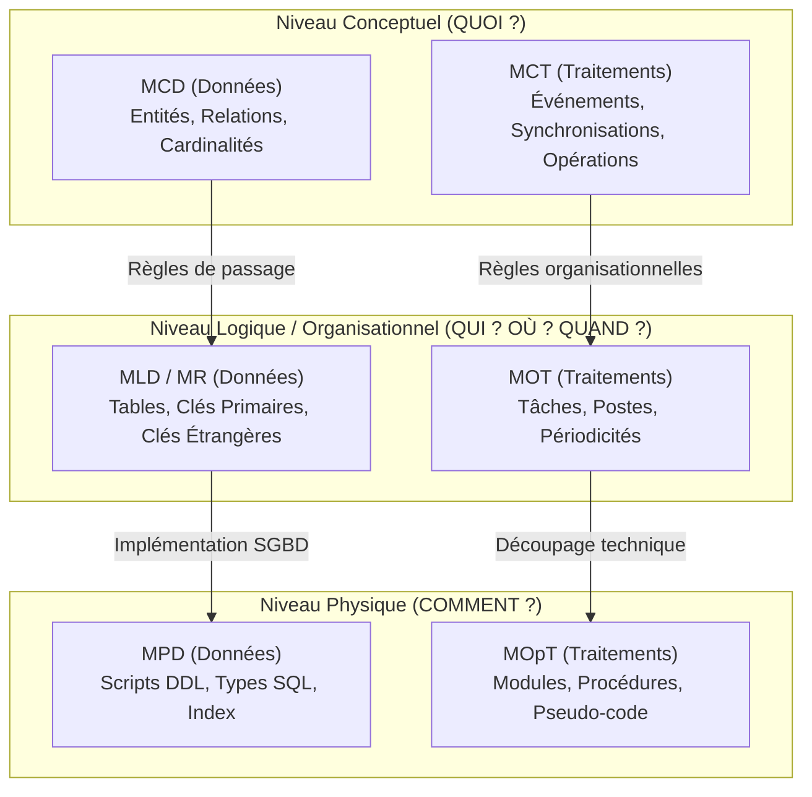

# 🗄️ Révision Bases de Données (Examen & TP Noté)

Fiche récapitulative centrale optimisée pour **Obsidian** avec liens bidirectionnels (`[[...]]`).

---

##  Vue d'ensemble du Cycle de Conception & Architecture

Dans la modélisation de bases de données relationnelles, on distingue deux architectures fondamentales :

### 1. Architecture normalisée ANSI/SPARC (1975)
- **Niveau Externe** : Vues utilisateurs / programmes applicatifs ([[SQL_Pratique_TP_et_Exams#DCL & Droits]]).
- **Niveau Conceptuel** : Structure globale canonique, sémantique des données et entités ([[Merise_MCD_MCT_MOT#1. Modèle Conceptuel des Données (MCD)]]).
- **Niveau Interne** : Organisation physique des fichiers, index et stockage disque ([[SQL_Pratique_TP_et_Exams#2. Langage de Définition de Données (LDD)]]).
- **Objectifs clés** : **Indépendance physique** (modifier le stockage sans casser le schéma conceptuel) et **indépendance logique** (modifier le schéma sans impacter les vues externes).

### 2. Matrice Méthodologique MERISE

---

##  Fiches de Révision Détaillées

- 📄 [[Merise_MCD_MCT_MOT]] : Tout sur l'analyse, la formalisation des règles de gestion/organisation, le **MCD**, le **MCT** et le **MOT**.
- 📄 [[Modele_Relationnel_et_Algebre]] : **Règles d'or de transformation MCD $\to$ MLD**, contraintes d'intégrité, et **opérateurs de l'algèbre relationnelle** (avec la division).
- 📄 [[SQL_Pratique_TP_et_Exams]] : Fiche mémo pour le TP noté (LDD: `CREATE`, `ALTER`, `DROP`; LMD: `JOIN`, `GROUP BY`, `HAVING`, sous-requêtes imbriquées, division SQL avec `NOT EXISTS`).