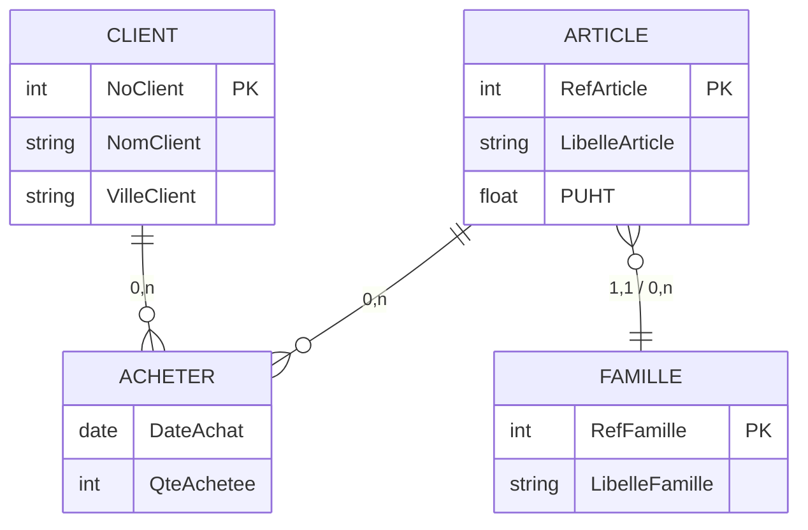
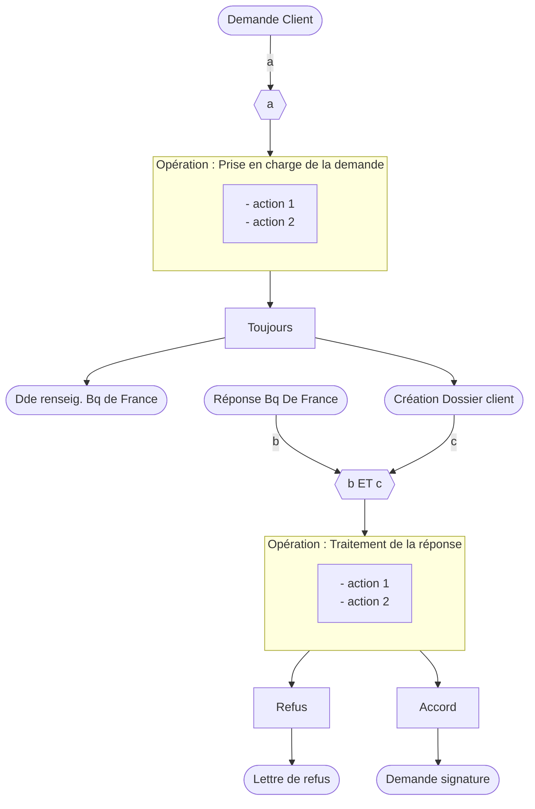

# 📐 Conception Merise : MCD, MCT, MOT

Lien : [[Index_Bases_de_Donnees]] | [[Modele_Relationnel_et_Algebre]]

---

## 1. Modèle Conceptuel des Données (MCD)

Le MCD répond à la question : **QUOI ?** (indépendamment du matériel et de l'organisation).

### Composants fondamentaux
- **Entité** : Objet ou individu ayant une existence propre (ex: `CLIENT`, `ARTICLE`).
- **Attribut / Propriété** : Donnée élémentaire qualifiant l'entité.
  - *Règle d'atomicité* : Les valeurs doivent être indivisibles (ex: `Nom` et `Prenom`, pas `NomPrenom`).
  - *Règle d'unicité* : Chaque attribut n'apparaît qu'une seule fois dans le MCD.
- **Identifiant (Clé primaire conceptuelle)** : Attribut unique permettant d'identifier sans ambiguïté chaque occurrence de l'entité (souligné dans le schéma).
- **Association / Relation** : Lien sémantique entre entités.
  - *Dimension* : Binaire (2 entités), Ternaire (3 entités), Réflexive (l'entité sur elle-même).
  - *Association porteuse* : Contient des propriétés dépendant de toutes les entités reliées (ex: `DateAchat`, `QteAchetee` sur `ACHETER`).

### Cardinalités
Couple `(min, max)` positionné côté entité :
- `min` : Nombre minimal de fois où une entité participe à l'association ($0$ ouou $1$).
- `max` : Nombre maximal de fois où une entité participe à l'association ($1$ ou $n$).

> **Note d'examen (C.I.F.)** : La relation a   vec cardinalité `(1,1)` (ex: `ARTICLE -> APPARTENIR -> FAMILLE`) représente une **Contrainte d'Intégrité Fonctionnelle**.

---

## 2. Modèle Conceptuel des Traitements (MCT)

Le MCT formalise le fonctionnement dynamique du Système d'Information (toujours au niveau **QUOI ?**).

### Concepts indispensables
1. **Événement** : Fait déclencheur (externe ou résultat interne).
2. **Synchronisation** : Condition booléenne (`ET`, `OU`) requise pour débuter l'opération.
3. **Opération** : Suite ininterruptible d'actions sur les données.
4. **Règles d'émission** : Conditions logiques définissant quel résultat est émis en sortie.

---

## 3. Modèle Organisationnel des Traitements (MOT)

Le MOT répond à : **QUI ? OÙ ? QUAND ?**

- **Poste de travail** (**OÙ**) : Accueil, Service comptabilité, Guichet.
- **Ressource & Nature** (**QUI**) : Automatique (Batch), Conversationnel (Écran/Saisie), Manuel.
- **Périodicité / Chronologie** (**QUAND**) : Immédiat, Fin de mois, Quotidien à minuit.
- **Règle des 3 unités d'une Phase (Procédure fonctionnelle)** : Même poste, Même période, Même nature d'action.